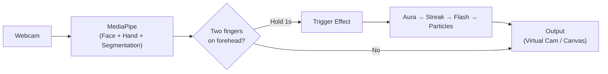

# ⚡ Instant Transmission — Vanish Webcam

Do Goku's **Instant Transmission** on your Google Meet calls. Hold two fingers (index + middle) to your forehead for ~1 second and you vanish with a full anime-style teleportation effect — charging aura, afterimage streak, white flash, energy ring, and particle disintegration. Do it again to reappear.

The project ships in **two flavours** that can be used independently:

| Mode | What it does |
|---|---|
| **Chrome Extension** | Runs entirely inside the browser — intercepts Google Meet's camera feed, detects the gesture with on-device MediaPipe, and composites the effect in real time via canvas. Zero setup beyond loading the extension. |
| **Python Desktop App** | Processes your webcam with OpenCV + MediaPipe, renders the effect, and outputs to a virtual camera (OBS Virtual Camera) that you select in *any* video-call app. |

---

## 🎬 How It Works



1. **Gesture Detection** — MediaPipe Hand Landmarker + Face Detector run every frame. The system checks that the index and middle fingers are extended, close together, ring & pinky are curled, and the fingertips overlap the detected forehead bounding box.
2. **Hold Gate** — The pose must be held for a configurable duration (default 1 s). A charging aura grows around the silhouette during this time. Brief tracking dropouts (< 250 ms) are tolerated.
3. **Teleport Effect** — A 0.7-second cinematic sequence:
   - **Afterimage streak** (0–17 %) — blue-tinted ghost copies shift upward with vertical speed lines.
   - **White flash + energy ring** (14–28 %) — radial gradient burst with expanding ring and screen shake.
   - **Particle disintegration** (18–100 %) — 800 energy particles scatter outward (vanishing) or coalesce inward (reappearing).
4. **Background swap** — At the 18 % cut point the live video is replaced with a captured empty-room background (or vice versa).

---

## 📂 Project Structure

```
vanish_webcam/
├── goku_vanish.py              # Python desktop app (webcam → virtual cam)
├── requirements.txt            # Python dependencies
├── models/                     # MediaPipe model files (auto-downloaded)
│   ├── blaze_face_short_range.tflite
│   ├── hand_landmarker.task
│   └── selfie_segmenter_landscape.tflite
│
└── chrome-extension/           # Manifest V3 Chrome Extension
    ├── manifest.json
    ├── generate_icons.py       # Script to regenerate extension icons
    ├── icons/
    │   ├── icon48.png
    │   └── icon128.png
    ├── content/
    │   ├── camera-hook.js      # MAIN world — hooks getUserMedia, runs effect
    │   └── bridge.js           # ISOLATED world — bridges popup ↔ page messaging
    ├── gesture/
    │   ├── gesture-worker.html # Hidden iframe host for MediaPipe
    │   └── gesture-worker.js   # Hand + face detection, hold-gate logic
    ├── popup/
    │   ├── popup.html          # Extension popup UI
    │   ├── popup.js            # Popup logic (toggle, capture BG, status)
    │   └── popup.css           # Dark theme styles
    ├── libs/mediapipe/         # Bundled MediaPipe Vision WASM runtime
    └── models/                 # Bundled ML models for the extension
```

---

## 🚀 Getting Started

### Chrome Extension (Recommended)

No Python, no virtual camera — works entirely in the browser.

1. Clone the repo:
   ```bash
   git clone https://github.com/<your-username>/vanish_webcam.git
   cd vanish_webcam
   ```
2. Open **chrome://extensions** in Chrome.
3. Enable **Developer mode** (top-right toggle).
4. Click **Load unpacked** and select the `chrome-extension/` folder.
5. Open a [Google Meet](https://meet.google.com) call — the extension automatically hooks the camera.
6. Look for the floating **⚡** button on the Meet page, or open the extension popup.

**Three ways to trigger:**

| Trigger | How |
|---|---|
| 🤞 Gesture | Hold index + middle fingers to your forehead for ~1 second |
| ⌨️ Hotkey | Hold <kbd>Alt</kbd> + <kbd>G</kbd> to charge and release to trigger |
| ⚡ Button | Click the floating button on the Meet page |

> **Tip:** Press <kbd>Alt</kbd> + <kbd>B</kbd> to capture a clean background frame (step out of view first) for the best vanish effect.

---

### Python Desktop App

Works with **any** video-call app (Google Meet, Zoom, Teams, Discord, etc.) via a virtual camera.

#### Prerequisites

- Python 3.10+
- [OBS Studio](https://obsproject.com/) installed (provides the OBS Virtual Camera)
- *(Optional)* [VB-Cable](https://vb-audio.com/Cable/) for sound routing to the call

#### Setup

```bash
cd vanish_webcam
pip install -r requirements.txt
python goku_vanish.py
```

On first run the script auto-downloads the MediaPipe models (~15 MB) into `models/`.

#### Usage

```bash
# Basic — preview window + virtual camera
python goku_vanish.py

# With a teleport sound effect
python goku_vanish.py --sound teleport.mp3

# Route audio to a virtual cable so call participants hear it
python goku_vanish.py --sound teleport.mp3 --audio-device "CABLE Input"

# List available audio devices
python goku_vanish.py --list-audio

# Preview only (no virtual camera)
python goku_vanish.py --no-virtual
```

#### CLI Options

| Flag | Default | Description |
|---|---|---|
| `--camera` | `0` | Camera device index |
| `--width` | `1280` | Capture width |
| `--height` | `720` | Capture height |
| `--fps` | `30` | Virtual camera frame rate |
| `--hold` | `1.0` | Seconds the pose must be held to trigger |
| `--sound` | — | Path to an audio file (wav/mp3/ogg) to play on teleport |
| `--audio-device` | — | Output device for sound (e.g. `CABLE Input`) |
| `--no-virtual` | — | Preview window only, no virtual camera output |
| `--no-hud` | — | Hide the status overlay on the preview window |

#### Preview Window Controls

| Key | Action |
|---|---|
| <kbd>Q</kbd> / <kbd>Esc</kbd> | Quit |
| <kbd>Space</kbd> | Recapture the background (step out of frame first) |
| <kbd>B</kbd> | Toggle background auto-refinement |

Then select **OBS Virtual Camera** as your camera in the video-call app.

---

## 🧠 Tech Stack

| Component | Technology |
|---|---|
| Gesture detection | [MediaPipe](https://developers.google.com/mediapipe) Hand Landmarker + Face Detector |
| Person segmentation | MediaPipe Selfie Segmenter (Python app only) |
| Video processing (Python) | [OpenCV](https://opencv.org/), [NumPy](https://numpy.org/) |
| Virtual camera | [pyvirtualcam](https://github.com/letmaik/pyvirtualcam) → OBS Virtual Camera |
| Sound playback | [Pygame](https://www.pygame.org/) |
| Browser compositing | Canvas 2D API + `captureStream()` |
| Browser ML runtime | MediaPipe Tasks Vision (WASM, bundled in extension) |
| Extension framework | Chrome Manifest V3 |

---

## 🎨 Regenerating Extension Icons

The icons are generated programmatically using Pillow:

```bash
cd chrome-extension
pip install Pillow
python generate_icons.py
```

This creates `icons/icon48.png` and `icons/icon128.png` — a dark circle with a cyan lightning bolt and glow effect.

---

## 🤝 Contributing

Contributions are welcome! Please open an issue or submit a pull request.

1. Fork the repo
2. Create a feature branch (`git checkout -b feature/amazing-thing`)
3. Commit your changes (`git commit -m 'Add amazing thing'`)
4. Push to the branch (`git push origin feature/amazing-thing`)
5. Open a Pull Request

---

## 📄 License

This project is licensed under the MIT License. See the [LICENSE](LICENSE) file for details.
