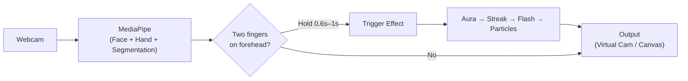

# ⚡ Instant Transmission — Vanish Webcam

Do Goku's **Instant Transmission** on your video calls! Hold two fingers (index + middle) to your forehead for a split second and you vanish with a full anime-style teleportation effect — charging aura, afterimage streak, white flash, energy ring, and particle disintegration. Do it again to reappear.

Works on **Google Meet, Zoom, Microsoft Teams, Discord, WhatsApp Web, OmeTV, Jitsi, Slack, Webex, and more** — or *any* desktop app using the Python virtual camera!

The project ships in **two flavours** that can be used independently:

| Mode | What it does |
|---|---|
| **Chrome Extension** | Runs entirely inside the browser — intercepts the camera feed on Google Meet, Zoom, Teams, Discord, WhatsApp Web, OmeTV, and 15+ web platforms. Detects gestures with on-device MediaPipe and composites the effect in real time via canvas. Zero setup beyond loading the extension. |
| **Python Desktop App** | Processes your webcam with OpenCV + MediaPipe, renders the anime teleport effect, and outputs to a virtual camera (OBS Virtual Camera) that you can select in **any** video-calling or streaming app (desktop or browser). |

---

## 🌐 Supported Platforms & Websites

### 1. Chrome Extension (In-Browser Hook)
The Chrome extension automatically intercepts the camera stream on supported websites without requiring OBS, Python, or virtual cameras:

| Category | Supported Services & Domains |
|---|---|
| 💼 **Meetings & Work** | **Google Meet** (`meet.google.com`)<br>**Zoom Web** (`*.zoom.us`)<br>**Microsoft Teams** (`teams.microsoft.com`, `teams.live.com`)<br>**Cisco Webex** (`*.webex.com`)<br>**Jitsi Meet** (`meet.jit.si`, `*.onjitsi.com`)<br>**Slack Huddles & Calls** (`app.slack.com`)<br>**Whereby** (`*.whereby.com`)<br>**Around** (`*.around.co`)<br>**Loom** (`*.loom.com`) |
| 💬 **Chat & Community** | **Discord Web** (`discord.com`)<br>**WhatsApp Web** (`web.whatsapp.com`)<br>**Facebook Messenger** (`messenger.com`)<br>**Gather Town** (`*.gather.town`) |
| 🎲 **Random Video Chat** | **OmeTV** (`ome.tv`, `*.ome.tv`)<br>**Minichat** (`*.minichat.com`)<br>**Chatrandom** (`*.chatrandom.com`)<br>**CooMeet** (`*.coomeet.com`) |

> 💡 **Adding Custom Websites:**  
> Want to support another WebRTC-based video chat site? You can easily add more domains! Open [`vanish_webcam/chrome-extension/manifest.json`](file:///d:/Projects/Instant%20Transmission%20-%20Copy/vanish_webcam/chrome-extension/manifest.json) and add your target URL pattern to `host_permissions`, `content_scripts.matches`, and `web_accessible_resources.matches`, then reload the extension in `chrome://extensions`.

---

### 2. Python Desktop App (Universal Compatibility)
The Python version routes video frames through [pyvirtualcam](https://github.com/letmaik/pyvirtualcam) into **OBS Virtual Camera**. This makes it universally compatible with **any application that uses a webcam**:
- **Desktop Apps**: Zoom, Discord Desktop, Microsoft Teams Desktop, Skype, Slack Desktop, Telegram, OBS Studio, Streamlabs, etc.
- **Any Web Browser**: Chrome, Firefox, Edge, Brave, Safari, Opera, etc.

---

## 🎬 How It Works



1. **Gesture Detection** — MediaPipe Hand Landmarker + Face Detector run in real time. The system validates that the index and middle fingers are extended and touching, ring & pinky are curled, and fingertips overlap the detected forehead region.
2. **Hold Gate & Aura** — The pose must be held for a brief moment (~0.6s in the Chrome extension, ~1.0s configurable in Python). A luminous anime charging aura radiates around your silhouette as the charge builds up. Brief tracking dropouts (< 250 ms) are gracefully tolerated.
3. **Teleport Effect Sequence** (0.7 seconds total):
   - **Afterimage streak** (0–17 %) — blue-tinted ghost copies streak upward with vertical speed lines.
   - **White flash + energy ring** (14–28 %) — radial gradient burst with expanding shockwave ring and screen shake.
   - **Particle disintegration** (18–100 %) — 800 energy particles scatter outward (vanishing) or coalesce inward (reappearing).
4. **Background Swap** — At the 18 % cut point, the live video seamlessly cuts to a captured empty-room background (vanishing) or back to the live webcam (reappearing).

---

## 📂 Project Structure

```
vanish_webcam/
├── goku_vanish.py              # Python desktop app (webcam → virtual cam)
├── requirements.txt            # Python dependencies
├── assets/                     # Audio files & SFX
│   ├── teleport.mp3            # Default instant transmission sound
│   └── vanish.mp3              # Alternative teleport sound
├── models/                     # MediaPipe model files (auto-downloaded)
│   ├── blaze_face_short_range.tflite
│   ├── hand_landmarker.task
│   └── selfie_segmenter_landscape.tflite
│
└── chrome-extension/           # Manifest V3 Chrome Extension
    ├── manifest.json           # Extension config & supported site matches
    ├── generate_icons.py       # Script to regenerate extension icons
    ├── icons/
    │   ├── icon48.png
    │   └── icon128.png
    ├── content/
    │   ├── camera-hook.js      # MAIN world — hooks getUserMedia, renders effect
    │   └── bridge.js           # ISOLATED world — bridges popup ↔ page messaging
    ├── gesture/
    │   ├── gesture-worker.html # Hidden iframe host for MediaPipe
    │   └── gesture-worker.js   # Hand + face detection, hold-gate logic
    ├── popup/
    │   ├── popup.html          # Extension popup UI
    │   ├── popup.js            # Popup logic (toggle, capture BG, status)
    │   └── popup.css           # Dark theme styles
    ├── libs/mediapipe/         # Bundled MediaPipe Vision WASM runtime
    └── models/                 # Bundled ML models for the extension
```

---

## 🚀 Getting Started

### Option A: Chrome Extension (Recommended)

No Python, no virtual camera installation — works right inside your browser.

1. **Clone or download the repo:**
   ```bash
   git clone https://github.com/<your-username>/vanish_webcam.git
   cd vanish_webcam
   ```
2. Open **`chrome://extensions`** in Google Chrome.
3. Enable **Developer mode** (toggle in the top-right corner).
4. Click **Load unpacked** and select the `vanish_webcam/chrome-extension/` folder.
5. Open any supported video call (e.g., [Google Meet](https://meet.google.com), [Zoom](https://zoom.us), [Teams](https://teams.microsoft.com), [Discord](https://discord.com), [OmeTV](https://ome.tv), etc.).
6. When your camera turns on, the extension automatically intercepts the stream. Look for the floating **⚡** button on the bottom-right or open the extension popup.

#### 🎮 Four Ways to Trigger:

| Trigger | How to use |
|---|---|
| 🤞 **Gesture** | Hold index + middle fingers against your forehead for ~0.6 seconds |
| ⌨️ **Hotkey** | Hold <kbd>Alt</kbd> + <kbd>G</kbd> to charge up the aura, release to teleport |
| ⚡ **Floating Button** | Click the floating glowing button on the video call page |
| 🫥 **Popup Button** | Click **Vanish / Reappear** in the extension popup menu |

> **📸 Background Capture Tip:**  
> Press <kbd>Alt</kbd> + <kbd>B</kbd> (or click **Capture Background** in the popup) while stepping out of frame for 2 seconds. Having a clean background snapshot produces the cleanest vanish effect!

---

### Option B: Python Desktop App

Works with **any** video-calling or streaming app (Google Meet, Zoom, Teams, Discord, Skype, OBS, etc.) via a virtual camera.

#### Prerequisites

- Python 3.10+
- [OBS Studio](https://obsproject.com/) installed (provides the OBS Virtual Camera driver)
- *(Optional)* [VB-Cable](https://vb-audio.com/Cable/) for routing teleport sound effects into the call microphone

#### Setup

```bash
cd vanish_webcam
pip install -r requirements.txt
python goku_vanish.py
```

On first run, the script auto-downloads the required MediaPipe models (~15 MB) into `models/`.

#### Usage

```bash
# Basic — preview window + virtual camera output (with default teleport sound)
python goku_vanish.py

# Use a custom sound effect
python goku_vanish.py --sound assets/vanish.mp3

# Route audio to a virtual cable so call participants hear it
python goku_vanish.py --sound assets/teleport.mp3 --audio-device "CABLE Input"

# List available audio devices to find your VB-Cable input name
python goku_vanish.py --list-audio

# Preview only (no virtual camera)
python goku_vanish.py --no-virtual
```

#### CLI Options

| Flag | Default | Description |
|---|---|---|
| `--camera` | `0` | Camera device index |
| `--width` | `1280` | Capture width |
| `--height` | `720` | Capture height |
| `--fps` | `30` | Virtual camera frame rate |
| `--hold` | `1.0` | Seconds the pose must be held to trigger |
| `--sound` | `assets/teleport.mp3` | Audio file (wav/mp3/ogg) played on teleport |
| `--audio-device` | — | Output audio device name (e.g. `CABLE Input`) |
| `--list-audio` | — | List available audio output devices and exit |
| `--no-virtual` | — | Preview window only, without virtual camera output |
| `--no-hud` | — | Hide the status HUD overlay on the preview window |

#### Preview Window Controls

| Key | Action |
|---|---|
| <kbd>Q</kbd> / <kbd>Esc</kbd> | Quit application |
| <kbd>Space</kbd> | Recapture background (step out of frame first) |
| <kbd>B</kbd> | Toggle background auto-refinement |

After starting the script, select **OBS Virtual Camera** as your camera in Zoom, Discord, Meet, or any other software.

---

## 🧠 Tech Stack

| Component | Technology |
|---|---|
| Gesture detection | [MediaPipe](https://developers.google.com/mediapipe) Hand Landmarker + Face Detector |
| Person segmentation | MediaPipe Selfie Segmenter (Python app) |
| Video processing (Python) | [OpenCV](https://opencv.org/), [NumPy](https://numpy.org/) |
| Virtual camera output | [pyvirtualcam](https://github.com/letmaik/pyvirtualcam) → OBS Virtual Camera |
| Audio playback | [Pygame](https://www.pygame.org/) |
| Browser compositing | Canvas 2D API + `captureStream()` |
| Browser ML runtime | MediaPipe Tasks Vision (WASM, bundled inside extension) |
| Extension framework | Chrome Manifest V3 (MAIN & ISOLATED world bridge) |

---

## 🎨 Regenerating Extension Icons

The extension icons are generated programmatically using Pillow:

```bash
cd vanish_webcam/chrome-extension
pip install Pillow
python generate_icons.py
```

This creates `icons/icon48.png` and `icons/icon128.png` — a dark badge with a cyan lightning bolt and neon glow effect.

---

## 🤝 Contributing

Contributions are welcome! If you'd like to add support for more websites, improve performance, or enhance visual effects:

1. Fork the repo
2. Create a feature branch (`git checkout -b feature/awesome-feature`)
3. Commit your changes (`git commit -m 'Add awesome feature'`)
4. Push to the branch (`git push origin feature/awesome-feature`)
5. Open a Pull Request

---

## 📄 License

This project is licensed under the MIT License. See the [LICENSE](LICENSE) file for details.

